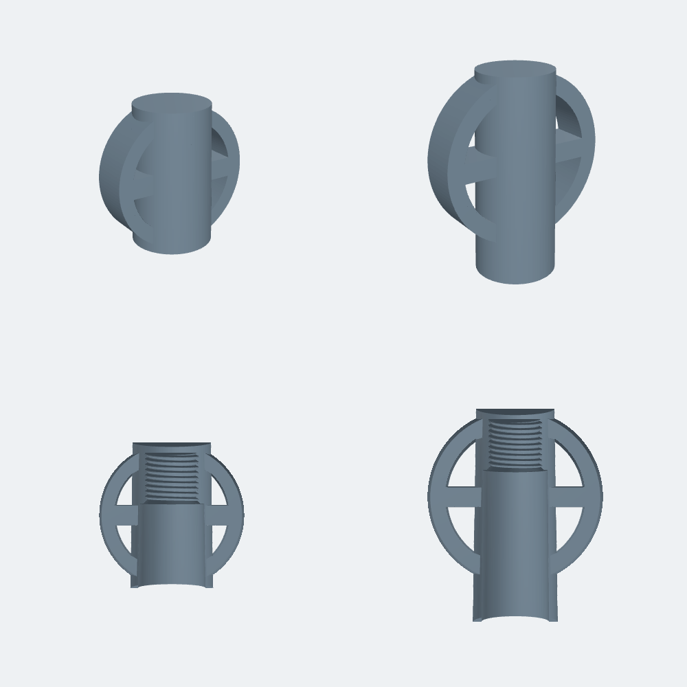

# Bouchons de valve « croix » (valve Schrader moto, filetage 8V1 0.305″-32 UNEF)

Le filetage est logé tout en haut de la branche verticale (1,5 mm sous le sommet).
Version minimaliste : un seul tube central droit (Ø ext 11,6 en haut → 12,3 / 12,6 en bas, Ø int 9,6 → 10), sans marche, qui descend jusqu'à 2 mm de la jante. Anneau 2,2–2,6 mm, bras 3 mm.

| Fichier | Hauteur de tige H (haut de valve → jante) | Dimensions (mm) | Masse résine |
|---|---|---|---|
| `bouchon_croix_H22.stl` | 22 à 31 mm (TR412) | 21,5 × 12,3 × 21,5 | ≈ 2,0 g |
| `bouchon_croix_H32.stl` | 32 mm et plus (TR413) | 26 × 12,6 × 31,5 | ≈ 2,9 g |

- Valve à corps droit, Ø ≤ 9,2 mm sous la partie filetée.
- Unités : millimètres, échelle 100 %. Ne pas redimensionner (taraudage au pas réel 0,794 mm).
- Orientation : ouverture vers le haut, sommet du bouchon à z = 0. Surélever de 3 à 5 mm sur supports dans le slicer.
- Taraudage : Ø 8,00 fond / Ø 7,15 sommet (jeu ≈ 0,25 mm au diamètre pour la résine).
- Autre hauteur de tige : `pip install manifold3d numpy`, modifier `version_v3(H)` dans `model.py`, puis `python model.py <dossier>`.

